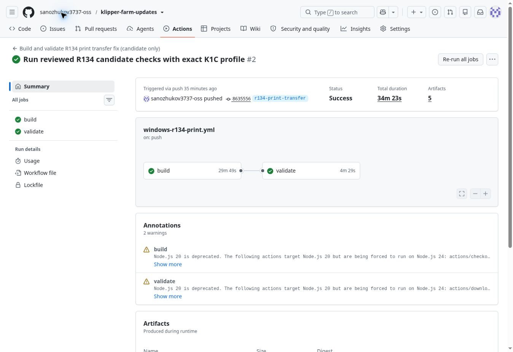

# Klipper Farm R134 — проверенный установщик

Windows-сборка и проверка установки прошли: [Actions run 39639323011](https://github.com/sanozhukov3737-oss/klipper-farm-updates/actions/runs/39639323011), commit `863555626a6563c5a11a4ea575031d8b3df2f291`.

Исправления: отправка файлов через рабочий порт actor на K1C/Forge-X; сохранение исходного Unicode-имени в загрузке и запуске; завершение проверки при оборванных HTTP-заголовках; отклонение ложного подтверждения загрузки; защита от повторной команды в неопределённом диалоге; обновление только диагностических сведений о модели не отменяет проверенный файл.

Нативные тесты: 199 прошли, 0 ошибок, 2 ранее отключённых. Отдельные сетевые harness проверили точные UTF-8-имена, файл 25 МБ, HTTP/JSON-ошибки, отсутствие повторной отправки и повреждённые ответы. Windows UI-проверки и 92 случая сохранения имён прошли.

Установка поверх R133, точные байты установленного приложения, запуск, работа установленной службы с локальным эмулятором, сохранность конфигурации 7 тестовых принтеров/2 катушек и SQLite, повторный запуск проверены. Физические принтеры пользователя не подключены.

Установщик: `Klipper-Farm-R134-setup.exe`, 233754545 байт, SHA-256 `670ff8218d7d8146e8565b3e3192150aed1430dc790388f8457736474adcbe82`. Артефакт: `r134-reviewed-installer`, ID 12365629020. Полные provenance и контрольные суммы — в `r134-candidate-review.json`.

Пользователь разрешил сборку и тесты. Публикация R134 не разрешена и не выполнялась. Публичный канал остаётся на R133. Первый ранний прогон остановлен до нативной компиляции для исправления двух неточностей в проверках; итоговый прогон полностью успешен.

