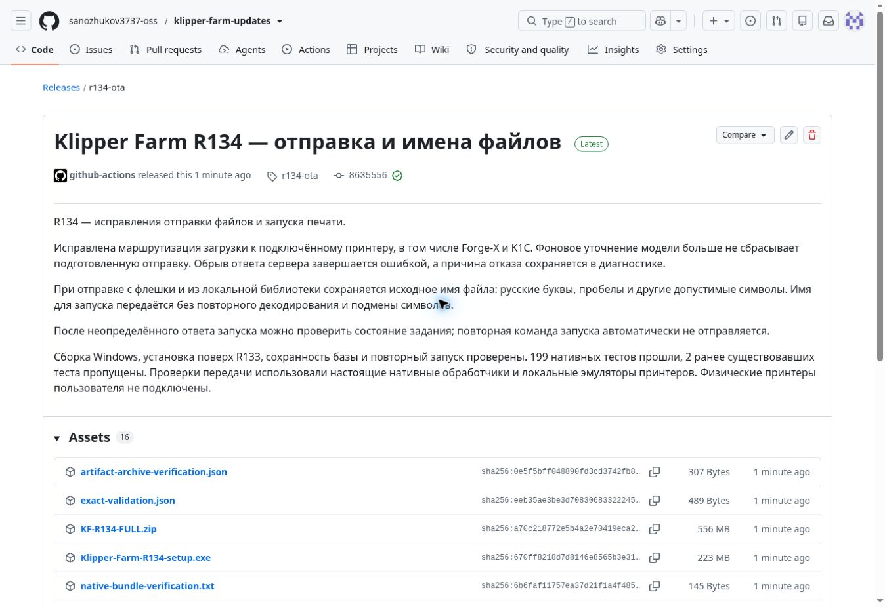

# Klipper Farm R134 — опубликован

R134 опубликован как стабильный [релиз GitHub](https://github.com/sanozhukov3737-oss/klipper-farm-updates/releases/tag/r134-ota). Подписанный канал приложения переведён с R133 на R134.

[Скачать установщик](https://github.com/sanozhukov3737-oss/klipper-farm-updates/releases/download/r134-ota/Klipper-Farm-R134-setup.exe). В приложении: «Проверить обновления».

Исправлены маршрутизация отправки к подключённому принтеру, сохранение исходных русских имён и пробелов при загрузке и запуске, обработка оборванного ответа и ложного подтверждения загрузки. Уточнение диагностических сведений о модели не отменяет проверенный файл. После неопределённого ответа запуска доступна проверка задания без автоматического повторного запуска.

Опубликован именно проверенный установщик, без повторной сборки. Размер: 233754545 байт. SHA-256: `670ff8218d7d8146e8565b3e3192150aed1430dc790388f8457736474adcbe82`.

Windows-сборка и установка поверх R133 с сохранением базы и повторным запуском прошли: [run 39639323011](https://github.com/sanozhukov3737-oss/klipper-farm-updates/actions/runs/39639323011). 199 нативных тестов прошли, 0 ошибок, 2 ранее отключённых. Проверены реальные нативные обработчики передачи и локальные эмуляторы. Физические принтеры пользователя не подключены.

[Публикация и проверка штатным Rust-модулем обновлений](https://github.com/sanozhukov3737-oss/klipper-farm-updates/actions/runs/39647703023) завершены успешно. Публичные manifest и установщик скачаны повторно, подпись и точные байты проверены. R133 получает обновление, установленный R134 повторно не предлагается. Контрольные суммы и проверка канала: `r134-public-verification.json`; provenance: `r134-candidate-review.json`.

Manifest SHA-256: `bcba3cbca1edbf8de32ec74b01280e19052ffe494ac1c148bc016b820d9ccc1d`. Версия: `1.14.5-r134`, sequence: 134. Release ID: 419878472. Утверждённый build commit: `863555626a6563c5a11a4ea575031d8b3df2f291`.

