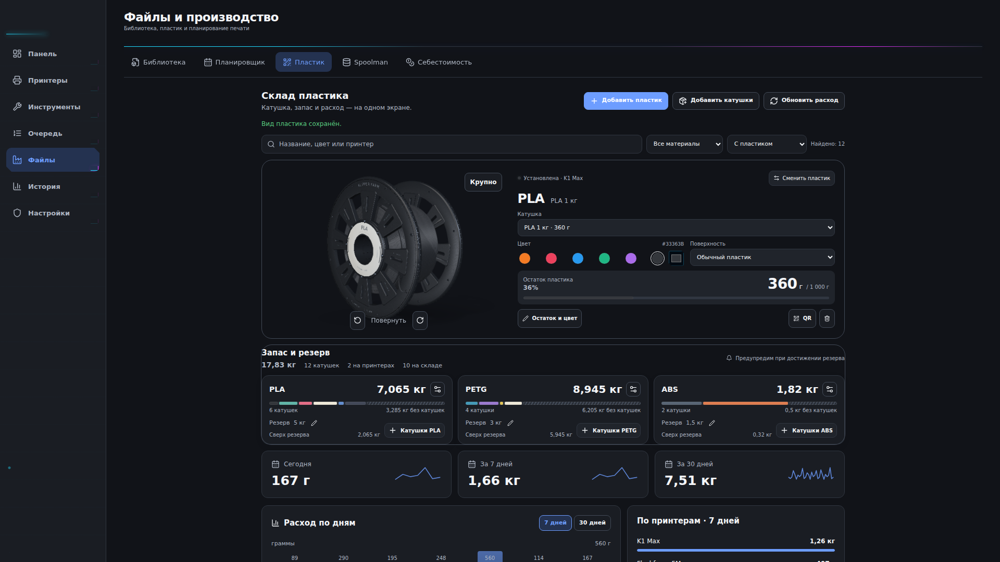
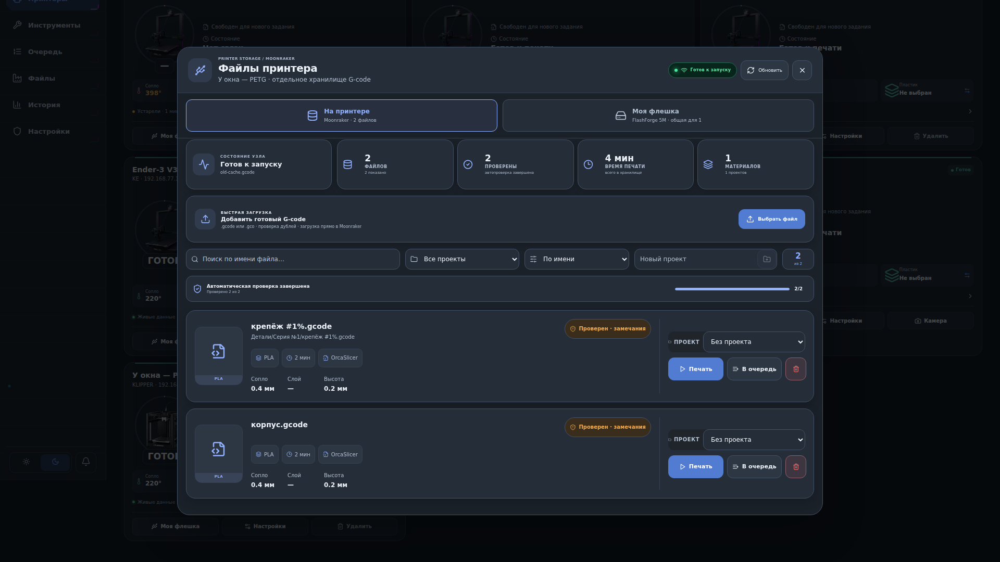
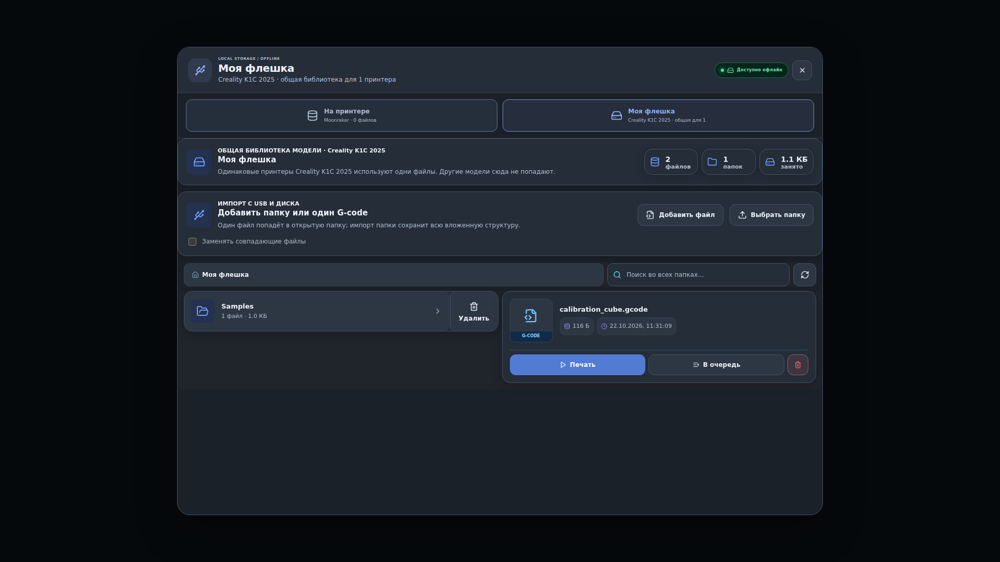

# R135 — Windows-проверка завершена, публикация подготовлена

Пользователь утвердил окончательный вид и выпуск R135. [Windows-сборка №39775532127](https://github.com/sanozhukov3737-oss/klipper-farm-updates/actions/runs/39775532127) завершилась успешно: сборка, установка поверх R134, сохранность данных принтеров и пластика, побайтовая проверка установленного пакета и повторный запуск. Проверенный установщик подписан прежним ключом издателя для последовательности 135. Подготовлена публикация этого же пакета через штатный канал обновления; до её успешной проверки стабильным остаётся R134.

- Пластик: взяты исходные компоненты опубликованного R134. Их ширина, расположение, размеры катушки и отступы сохранены. Превью переснято в масштабе последнего пользовательского скриншота: 125%, изображение 1920×1200, блок шириной 1400 физических пикселей с границами x≈388…1788. Две рамки охватывают цельный блок катушки со сведениями и цельный блок «Запас и резерв» с карточками. Отдельной заливки и дополнительного внешнего окна нет. Верхняя рамка меняет цвет существующей прозрачной границы; нижняя использует outline, поэтому содержимое не сдвигается.
- Файлы принтера и «Моя флешка»: скруглены карточки, поля, кнопки и статусы; убраны неоновые края и срезанные углы; характеристики и действия не обрезаются карточкой.
- Удалён весь блок «Расход по принтерам», ручное списание и кнопки подтверждения/пропуска ожидающего расхода. Фактический расход автоматически сверяется с историей после восстановления связи. Ожидание данных не подменяется примерным весом файла. Существующие запасы, привязки и журнал сохранены.
- Flashforge Adventurer 5M: исправлено чтение вложенных ответов состояния, добавлено автоматическое наблюдение за запуском после задержки ответа. Проверка состояния не загружает файл повторно и не отправляет второй запуск.
- В сетевой части Windows после принятой команды восстанавливаются только запросы состояния. Единственный REST-запуск разрешён при доказанном отказе WebSocket до приёма команды; просроченная команда не записывается в сокет.

## Вид приложения

Снимки настоящих компонентов приложения на тестовых данных; это не изображения, сгенерированные по описанию.







Светлая тема: [пластик](r135-plastic-light.png), [файлы принтера](r135-printer-files-light.png), [моя флешка](r135-local-library-light.png).

## Что проверено

- TypeScript и production-сборка интерфейса прошли.
- Дополнительно напрямую сопоставлены исходные R134 и окончательные компоненты при масштабе 125% с пятью тестовыми материалами: обе темы, идентичные координаты катушки, сведений, заголовка и всех карточек; ширина блока 1400 px, боковой панели 255 px. Инвентаризация в превью синтетическая, пользовательские остатки в пакет не переносились.
- 38 сценариев клиентского запуска на собранном production-коде прошли. Те же проверки на исходном R134 воспроизвели 26 отказов. Сетевая граница в этих проверках эмулируется.
- 26 сценариев автоматического наблюдения в настоящих обработчиках/effect и 9 прежних проверок файлового запуска прошли.
- Для окончательной компоновки заново прошли 7 браузерных сценариев страницы: обе рамки выровнены по ширине, катушка и сведения находятся вместе в первой, запас ниже во второй; основные действия видны, выбор обновляет остаток, пустой результат поиска не скрывает запас и расход, просмотр не меняет журнал.
- На предыдущем этапе также прошли 15 браузерных сценариев автоматического учёта, 17 инвентаризации и 7 склада. Логика списаний этой сменой компоновки не изменялась.
- 24 проверки оформления: три экрана × две темы × четыре размера окна (1920, 1366, 910, 390). Ошибок выполнения не обнаружено. Дополнительно проверены две отдельные прозрачные скруглённые рамки, прежняя компактная ширина до 1120 px, размещение запаса ниже целого блока катушки и отсутствие лишней внешней рамки вокруг всей страницы.
- Отдельно в браузере прошли 12 функциональных сценариев файлов, включая позднее подтверждение с ровно одной загрузкой и одним запуском. Их вывод наблюдался в инструменте; отдельный сырой лог не сохранён.
- [Нативная проверка Windows №39754302756](https://github.com/sanozhukov3737-oss/klipper-farm-updates/actions/runs/39754302756) завершена успешно: **203 passed, 0 failed, 2 ignored**, включая четыре новых теста сетевого поведения. Проверялись точные два нативных файла текущего патча поверх R134; production-интерфейс в этом задании CI не собирался.

Физического доступа к пользовательскому 5M нет. Реальный запуск на его принтере пока не проверен; испытания кода не подтверждают поведение конкретной прошивки. Данных о том, начал ли принтер печать после последней отправки, пользователь пока не предоставил.

## Точный исходный код и продолжение

Исходная база: опубликованный `KF-R134-FULL.zip`, 582861134 байта, SHA-256 `a70c218772e5b4a2e70419eca2fe76ebb657bcc5f268667d795c56c0f88b3f4a`.

`r135-combined-patch.json` содержит 21 изменённый исходный файл и 3 новых теста, а также полный список контрольных сумм 1783 файлов базы. SHA-256 патча: `624b525f9f7afcfe36d5f3a23a9c770b53a25af2face834a7da8cef5df39db5f`.

Для восстановления в новую папку:

```text
python apply-r135.py KF-R134-FULL.zip NEW_DIRECTORY
```

Для проверки уже восстановленной папки:

```text
python apply-r135.py --verify EXISTING_SOURCE_DIRECTORY
```

`r135-review-evidence.zip` содержит отчёты, контрольные суммы файлов, полный текст изменений, снимки экранов, журнал production-сборки и журнал успешных нативных тестов Windows. Контрольные суммы ZIP и патча находятся в соседних `.sha256` файлах. Два нативных файла полного патча побайтово совпадают с файлами успешного Windows CI, commit `086ec47d89694176f75d76e3117fd0a805294b23`.

Сборка использует согласованный патч из 24 файлов и отдельный идентификатор выпуска из 5 файлов (`r135-release-identity.json`, SHA-256 `f0948ba05afdc6abe0fedf07213cb142cf8763b5c66aba5d2b7ae32d21524416`). Идентификатор `V20.6-R13.5-FRAMES-AUTO-PRINT-2026-10-22`, установленная последовательность обновления 135. После успешной Windows-проверки выполняется подпись прежним ключом и публикация штатного канала. До подтверждения установки и публикации не выдавать этот этап за готовое обновление.
