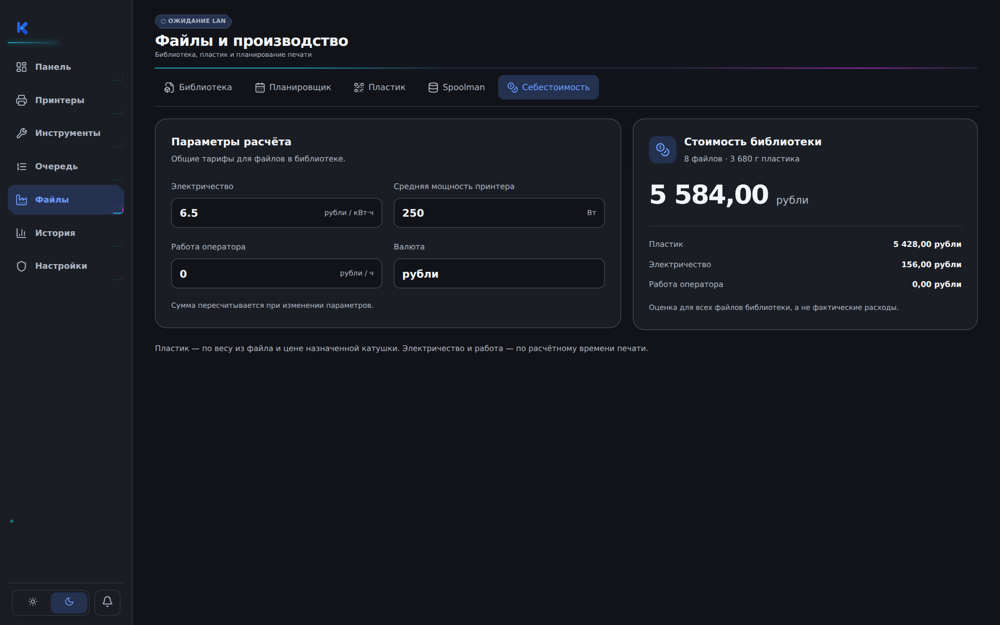
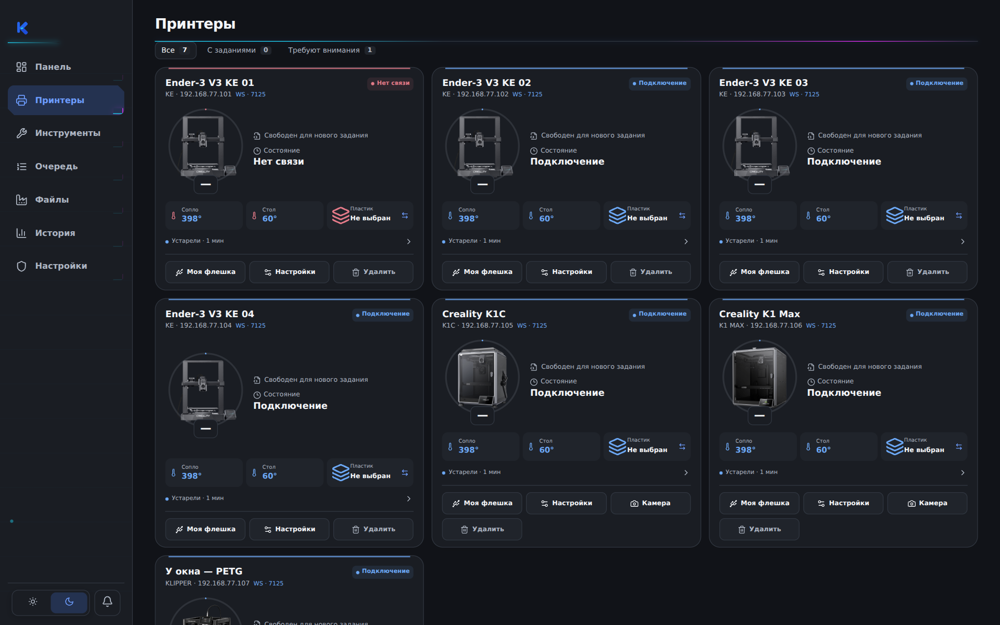

# R136 — себестоимость и три утверждённых фото

Пользователь утвердил вид и выпуск R136 с дополнительным условием: без оранжевых акцентов. Оранжевые полосы и состояния подключения, устаревшие значения и индикаторы заменены синими в обеих темах. Фотографии и реальные выбранные цвета пластика сохранены. Подготовлена сборка Windows из точных утверждённых файлов; после успешной установки поверх R135, проверки сохранности данных и запуска будет подписан и опубликован тот же пакет. До подтверждённой публикации штатный канал остаётся R135.

## Что изменено

Вкладка «Себестоимость»: четыре подписанных поля с единицами измерения и отступами, две скруглённые поверхности в текущей палитре приложения, заметный итог с разбивкой на пластик, электричество и работу. На узком экране блоки перестраиваются. Общий фон, соседние вкладки и раздел пластика не менялись. Формула оценки и механизм сохранения тарифов остались прежними; для разбивки суммируются уже существующие результаты оценки файлов.

Фотографии KE, K1C 2025 и K1 Max взяты байт в байт из пользовательского архива `Klipper-Farm-3-Printer-Photos(1).zip`. Все три изображения прозрачные PNG 1280×1280. Заменены существующие ассеты общего выбора изображения: главная, «Принтеры», подробная карточка и выбор модели используют новые фотографии без изменения профилей. Пропорции и полный силуэт сохранены. Катушка остаётся отдельным элементом. Flashforge и пользовательские фотографии не менялись.

## Вид

Снимки настоящих компонентов приложения. Принтеры, тарифы и суммы в превью — синтетические данные; реальные настройки пользователя не переносились.





Светлая тема: [себестоимость](r136-cost-light.png), [принтеры](r136-printers-light.png).

## Проверки

- TypeScript и штатная production-сборка интерфейса прошли; новые три PNG включены в сборку с новыми URL по содержимому.
- Браузерный прогон настоящего FarmApp: 29 проверок — обе темы, четыре размера окна для себестоимости, пересчёт и сохранение после повторного открытия, три модели на главной, в списке и подробной карточке, повторный запуск. Ошибок выполнения нет.
- После окончательной замены оранжевого на синий повторены все 29 проверок. Дополнительно проверяются вычисленные цвета LAN-индикатора, полос карточек, статусов подключения, устаревших температур и индикаторов связи в обеих темах; blueAccentsVerified=true. Ошибок выполнения нет.
- Каталог: 7 сценариев на 500 моделях; профили R126: 13 сценариев; проверка каталожных изображений и прозрачных ассетов прошла.
- Восстановление из точного опубликованного R135 с патчем проверяет 1786 файлов. Изменены ровно 8 файлов; native-код, настройки, профили, идентификаторы моделей и механизмы выбора изображений не менялись.
- Windows-установка и физические принтеры на этом этапе не проверялись.

## Изменённые файлы

```text
src/components/ProductionPanel.tsx
src/components/ProductionPanel.module.css
src/components/FleetLive.module.css
src/styles.css
src/assets/ender-v3-ke-integrated-v2.png
src/assets/creality-k1c-clean-v1144.png
src/assets/creality-k1-max-neon-v114.png
scripts/check-search-art.mjs
```

Последний файл — прежняя проверка ассетов: обновлены размер и hash KE, добавлены утверждённые K1C/K1 Max. Прежний guard Flashforge уже не совпадал с опубликованным R135; проверка закреплена на фактических неизменённых байтах R135 (1254×1254, SHA-256 `c82420d77620217fe60075b07af2003d99beae49f6ce697557485331334e072b`). Само изображение Flashforge не менялось.

## Точное восстановление

База: опубликованный `KF-R135-FULL.zip`, 582884837 байт, SHA-256 `d31f6ecd3fb1efdc0acceed0e794d7b8a24dd10d5cd34b7cc35f258e342b08f7`.

```text
python apply-r136.py KF-R135-FULL.zip NEW_DIRECTORY
```

`r136-window-photos-patch.json` содержит ровно 8 изменений и полный hash-инвентарь базы. Соседний `.sha256` закрепляет байты патча. `r136-review-evidence.zip` содержит браузерные отчёты, все снимки, проверку области изменений, журнал восстановления, production-сборки и временную браузерную fixture для повторения проверки. Это исходники и доказательства просмотра, не готовое обновление Windows. Идентичность выпуска R136 подготовлена отдельно в r136-release-identity.json: последовательность 136, buildId V20.6-R13.6-COST-PHOTOS-BLUE-2026-10-22, 5 файлов метаданных выпуска. Полная локальная сборка источника с обоими слоями проверена по всем 1786 файлам. Windows-сборка и проверка установки выполняются отдельно; не выдавать этот этап за опубликованный R136.
