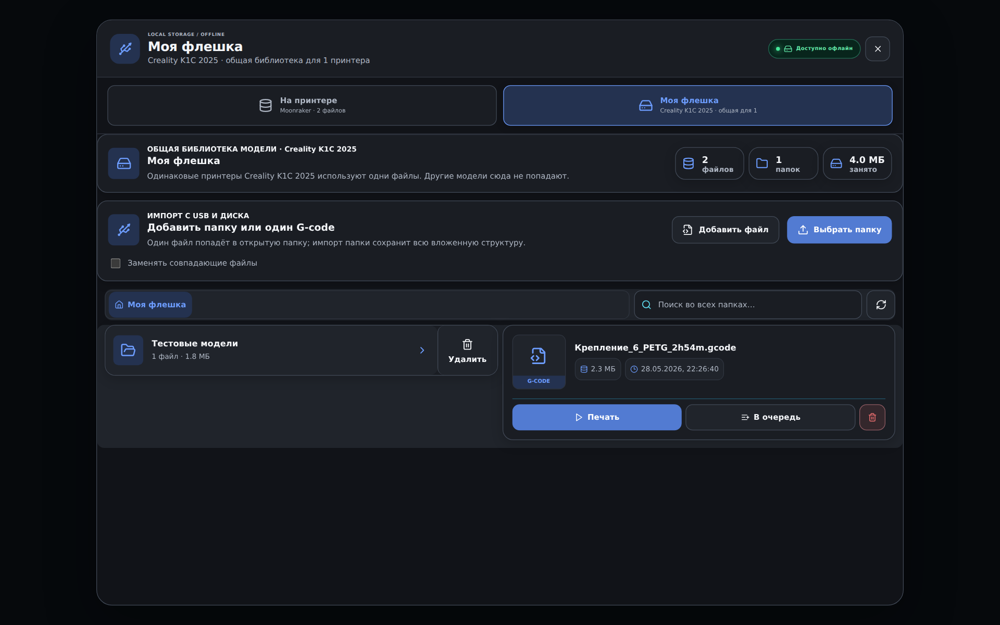

# R142 — графитовая палитра файлового окна

Подготовлен вариант поверх точного опубликованного R141. Это исходники и предварительный просмотр; установщик R142 ещё не собран, стабильный канал остаётся на R141.

Фон «Моей флешки», карточек и рамок использует общие переменные темы приложения. Синий остаётся на активных элементах и кнопках. Компоновка, размеры и доступность действий сохранены; светлая тема сохраняет прежнюю палитру.



## Проверено

- Изменён один рабочий файл: `src/styles.css`. Остальные 1319 исходных файлов вне dist совпадают с опубликованным R141.
- Полный TypeScript и production-сборка прошли.
- 12 сравнений настоящих файловых компонентов: две темы, ширины 1920, 910 и 390 CSS px, локальные и сохранённые удалённые файлы. Смещений блоков и горизонтального переполнения нет; доступность кнопок совпадает.
- Для сравнения подготовлено превью 1920×1200 при масштабе экрана 125%. Имена и файлы в нём тестовые.

## Короткое наблюдение за ресурсами

По 90 секунд на главной и TV, Chromium в Linux, семь синтетических принтеров и локальный неподвижный кадр камеры. Измеряется память JavaScript одного renderer, а не вся оперативная память программы.

| Экран | В начале, МиБ | Максимум, МиБ | В конце, МиБ |
|---|---:|---:|---:|
| Главная | 5.09 | 6.20 | 6.20 |
| TV | 3.87 | 136.53 | 4.39 |

Ошибок выполнения и внешних сетевых запросов не было. В TV замечен кратковременный пик памяти с последующим освобождением. По этому короткому замеру нельзя утверждать наличие утечки или долгосрочную стабильность. Причина пика требует отдельной проверки. Длительный замер на Windows, потоковые камеры и физические принтеры не проверялись; новая оптимизация памяти не заявляется.

## Воспроизведение изменения

Скачайте опубликованный `KF-R141-FULL.zip`, положите рядом `apply-r142-graphite.py` и `r142-graphite-patch.json`.

```sh
python apply-r142-graphite.py KF-R141-FULL.zip Klipper-Farm-R142
cd Klipper-Farm-R142
npm ci --ignore-scripts
npm run build
```

Скрипт проверяет SHA-256 полного архива и исходников, применяет только утверждённую палитру. Патч не является обновлением установленного приложения. Подпись и публикация нового установщика в этой работе не выполнялись.
